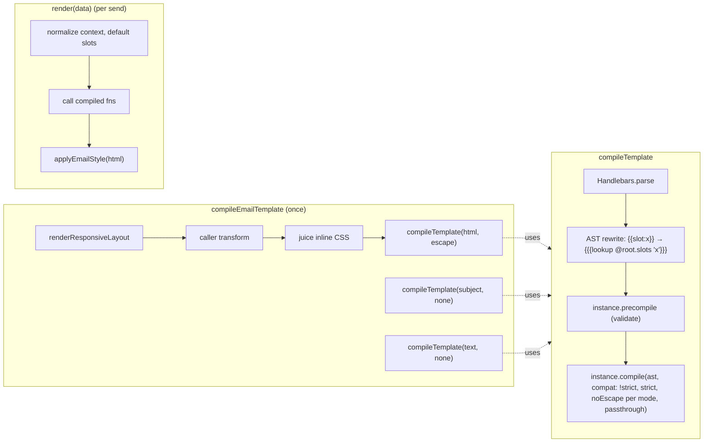
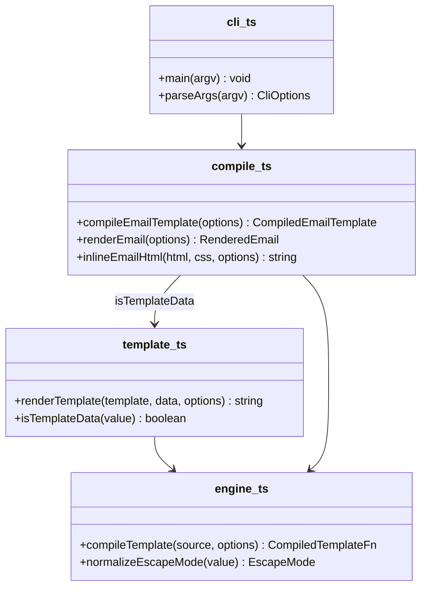

# Design Document

## Overview

The custom parser in `src/template.ts` is replaced by a thin layer over Handlebars 4.7. Every template string, whether the inlined HTML of a compiled email, its subject, its text, or a string passed to `renderTemplate`, goes through one function, `compileTemplate`, that parses with Handlebars, rewrites 3.x slot syntax in the AST, validates it with Handlebars' compiler, and compiles on an isolated Handlebars instance with `compat: true` and `noEscape` set from the Escape_Mode. The result is a function from data to string. `compileEmailTemplate` runs it once per template at compile time, so render is a function call with no parsing, which is the point of the package.

Escaping is Handlebars' own: `html` compiles with escaping on and `none` with `noEscape`. Handlebars' escape function is module-global, so the Library offers no entity set of its own; an earlier draft kept 3.x's exact entities through an AST rewrite, dropped because it left helper results unescaped for a difference no email client shows (Requirement 3). Strict mode is Handlebars' own `strict` compile option. It cannot be combined with `compat` (Handlebars 4.7 crashes with "Cannot use 'in' operator" on any single-segment lookup), so a strict compile turns `compat` off and strict templates use `../` or `@root.` for enclosing contexts, as Handlebars documents (Requirement 4). The CLI change is independent and small (Requirement 7).

## Architecture



The compile pipeline before Handlebars is unchanged from 3.x: layout tags, the caller's transform, then juice. Handlebars sees the same inlined HTML string that 3.x handed to its regex renderer, so the `transform`, `responsive` and `juice` options keep their order (Requirement 6.3).

**Key decision: native escaping.** `html` mode compiles with Handlebars' default escaping, so Variables, helper results and `lookup` go through `escapeExpression`, and a helper that returns HTML wraps it in `SafeString` exactly as Handlebars documents. `none` compiles with `noEscape: true`. Triple braces and slots stay raw in both. The Migration_Note records three visible differences: the apostrophe escapes as `&#x27;` rather than `&#39;`, `=` and the backtick are now escaped, and an object value renders as `[object Object]` rather than empty (Requirements 3.1 to 3.4, 3.7).

*Rejected:* an AST rewrite routing every `{{x}}` through a Library helper with a per-compile entity set. It preserved `&#39;` but turned escaping off for the whole template, so any helper result, including `lookup`, rendered raw unless the rewriter also wrapped helper calls; it also reserved a helper name and broke under `knownHelpersOnly`. *Rejected:* overriding `Handlebars.Utils.escapeExpression`: process-global.

**Key decision: strict mode is Handlebars' strict.** `strict` is read as `options.strict === true`, forwarded as Handlebars' `strict` compile option, and `compat` is set to `!strict`, because Handlebars 4.7 crashes when both are on (probed: "Cannot use 'in' operator to search for 'x' in 1"). The semantics are therefore Handlebars': a missing name or path segment in a direct reference or a bare block throws `"name" not defined in ...` with line and column; a field present as `null` renders empty; names used as helper parameters, including `{{#if}}` and `{{#each}}`, are not checked; a helper reading `this` works; a `TypeError` during a strict render, which a dotted path through a missing or null object or a helper given a missing value produces, is rethrown as `Strict render failed: ...` with a hint naming both causes and the original as `cause`. Trade-off: a strict template reaches an enclosing context with `../name` or `@root.name` rather than by fall-through, and `{{{slots.x}}}` follows strict like any variable, so strict templates reference slots as `{{slot:x}}` (Requirements 4.2 to 4.5).

*Rejected:* a Proxy on the root data object. With `compat` on, Handlebars treats a `null` in a row as a miss and falls through to the root, so any null-valued field threw; helpers reading the root threw; prototype names never threw. *Rejected:* Handlebars `strict` with `compat` kept on: crashes.

**Key decision: bare blocks follow Handlebars.** `{{#x}}...{{/x}}` is left to Handlebars' `blockHelperMissing`, which skips only `false`, `null`, `undefined` and an empty array, so a block over `0` or `""` renders. 3.x and Mustache skipped those too. The author chose upstream behaviour over an override so that Handlebars' documentation is true for this package; the Migration_Note points authors to `{{#if}}` and `{{#unless}}` for conditions on numbers and strings (Requirements 1.3, 1.11).

*Rejected:* registering a `blockHelperMissing` override that treats `0` and `""` as empty. Exact 3.x parity, but a private divergence from upstream and one more reserved helper name.

**Key decision: compile at `compileEmailTemplate` time.** The three compiled functions live in the closure of the returned `render`. The `html`, `subject` and `text` string fields stay as 3.x exposed them, so the Compiled_Template shape is unchanged (Requirement 6.1).

**Key decision: slot rewrite to the built-in `lookup` helper.** `{{slot:name}}` becomes a raw call to Handlebars' built-in `lookup` helper, `{{{lookup @root.slots "name"}}}`, rewritten in the parsed AST rather than the source text. Handlebars lexes `slot:name` as a single path whose `original` keeps the dotted text, so the visitor matches a param-less, hash-less mustache whose path begins `slot:`. `lookup` returns undefined for a missing key without consulting strict mode, so a missing slot renders empty in both modes; the string literal keeps `a.b` one key; `@root` reads the root as 3.x did, so an item's own `slots` cannot shadow it; and because the rewrite sees the AST, `\{{slot:x}}`, raw blocks and `{{~slot:x~}}` behave as Handlebars defines (Requirements 2, 4.3).

**Key decision: validate at compile time.** `instance.compile` generates code lazily on first render, so a fault Handlebars' compiler rather than its parser catches, such as a partial with two context arguments, would surface at the first send. `compileTemplate` runs `instance.precompile` on the same AST and options first, which throws now, then compiles as before. Cost: a second compilation per template at compile time, never per send (Requirement 1.10).

**Key decision: image inlining through `inlineExternal` before the CSS pass.** juice reads `webResources` only in its asynchronous entry points; 3.x called only the synchronous ones, so the option was dead. `inlineEmailHtml` now awaits `juice.inlineExternal` when any resource kind is requested, with `links`, `scripts` and `svgs` defaulting to false so a bare `images: true` fetches only images, and then runs the unchanged synchronous CSS path on the result. Each of the four options is `true`, `false` or a size cap in kilobytes. Resource inlining happens at compile time, before Handlebars renders, so a placeholder such as `{{logoUrl}}` cannot be inlined, and an unreachable host affects a deploy or cold start, never an individual send. By default an unreachable resource is skipped with juice's warning and its URL kept, so a dead image host cannot stop email workflows; a caller who wants the compile to fail instead opts in with `webResources.strict: true`. Probed: with images on, the output equals today's except for the inlined `src` attributes, which web-resource-inliner rewrites to the end of the tag (Requirements 7.2, 7.5, 7.6).

*Rejected:* switching to `juiceResources` with `extraCss`. It also applies `<style>` blocks inside the template, which `inlineContent` ignores, so CSS output would change for every caller who passes CSS.

**Key decision: Migration_Note in the repository.** `MIGRATION.md`, linked from the README, rather than the wiki the v3 note used, so it ships with the package and is reviewed in the same PR (Requirement 8.1).

## Components and Interfaces



### `src/engine.ts` (new)

Owns every contact with Handlebars.

| Operation | Input | Output | Requirements |
|---|---|---|---|
| `compileTemplate(source, options)` | template string; `{ escape, strict, handlebars }` | `(data: RenderData) => string` | 1.1 to 1.10, 2.1 to 2.4, 3.1 to 3.4, 3.7, 4.1 to 4.5, 5.1 to 5.3 |
| `normalizeEscapeMode(value)` | `EscapeMode \| boolean \| undefined` | `EscapeMode`, or throws | 3.2, 3.5, 3.8 |

Inside `compileTemplate`: create `Handlebars.create()`; register `options.handlebars.helpers`, then re-register Handlebars' built-in `lookup` so a caller helper of that name cannot hijack slots; read `strict = options.strict === true` and build `{ ...passthrough, compat: !strict, strict, noEscape: mode === 'none' }` where passthrough is `options.handlebars` minus `helpers`, `partials`, `compat`, `noEscape`, `strict`; register each `options.handlebars.partials` entry as a function compiled through the same pipeline, so a partial's `{{slot:x}}` is rewritten too; for each source: `Handlebars.parse`, the slot `Visitor`, `instance.precompile(ast, compileOptions)`, `instance.compile(ast, compileOptions)`. The returned function builds the root as `{ ...data, slots: data.slots ?? {} }` and calls the compiled template.

### `src/template.ts` (reduced)

| Operation | Input | Output | Requirements |
|---|---|---|---|
| `renderTemplate(template, data?, options?)` | as 3.x, options now `{ escape?, strict?, handlebars? }` | string | 6.1 |
| `isTemplateData(value)` | unknown | type guard | kept for `compile.ts` |

The block scanner, patterns and escape function are deleted (Requirement 1.1).

### `src/compile.ts` (changed)

| Operation | Change | Requirements |
|---|---|---|
| `compileEmailTemplate` | accepts `escape`, `strict`, `handlebars`; compiles html with the caller's mode, subject and text with `none`; `render` calls the three functions | 3.1, 3.6, 4.1, 5.1, 6.1 |
| `inlineEmailHtml` | when any of `webResources.images`, `links`, `scripts` or `svgs` is truthy, first await `juice.inlineExternal(html, { links: false, scripts: false, svgs: false, ...webResources })`, then run the synchronous `inlineContent` or `juice` call on its output as today. The defaults mean a bare `images: true` fetches only images; a caller may enable any of the four, or pass a size cap in kilobytes for each, through `juice.webResources`. web-resource-inliner processes scripts, links, images then SVG references in one pass | 6.3, 7.2, 7.5, 7.6 |
| `renderEmail`, `isRenderContext` | unchanged | 6.1, 6.3 |

### `src/cli.ts` (changed)

| Operation | Change | Requirements |
|---|---|---|
| `parseArgs` | `--inlineImages` sets `inlineImages: true`; `--noInlineImages` is accepted, sets nothing, and marks `deprecatedFlag` | 7.1 to 7.3 |
| `main` | passes `webResources.images: options.inlineImages` and `webResources.relativeTo` set to the directory of the input file; prints one deprecation line to stderr when the old flag was seen; help text updated | 7.1 to 7.5 |
| `parseArgs` | `--data <file>` sets `data`; `--strict` sets `strict: true` | 7.7, 7.8 |
| `main` | passes `strict: options.strict` to `compileEmailTemplate`; with `data`, reads and `JSON.parse`s the file (a `CliError` naming the file on a read or parse failure), calls `compiled.render(parsed)` and writes its `html`; without it, writes `compiled.html` as before. The CLI is a local test of the email, so it renders the way the library does | 7.7, 7.8 |

### Documentation

`README.md` gains Escape_Mode, Strict_Mode, Inverted_Block, Engine_Options and the two slot forms, and links `MIGRATION.md` (Requirements 8.1, 8.2).

## Data Models

```ts
export type EscapeMode = 'html' | 'none';

import type { HelperDelegate } from 'handlebars';

export interface EngineOptions {
  helpers?: Record<string, HelperDelegate>;
  partials?: Record<string, string>;
  [compileOption: string]: unknown;
}

export interface RenderTemplateOptions {
  escape?: EscapeMode | boolean;
  strict?: boolean;
  handlebars?: EngineOptions;
}

export interface CompileEmailTemplateOptions {
  // 3.x fields unchanged
  escape?: EscapeMode | boolean;
  strict?: boolean;
  handlebars?: EngineOptions;
}
```

| Field | Values | Notes |
|---|---|---|
| `escape` | `'html'` (default), `'none'`, `true` = html, `false` = none | any other value throws (Req 3.8) |
| `strict` | boolean, default `false`; forwarded to Handlebars and turns `compat` off | Req 4.1, 4.4 |
| `handlebars.helpers`, `handlebars.partials` | registered on the per-compile instance | Req 5.1, 5.2 |
| other `handlebars.*` | forwarded to `compile` | reserved: `compat`, `noEscape`, `strict`; a `helpers.lookup` entry is replaced by the built-in (Req 5.3) |

Escape sets:

| Mode | Characters | Entities |
|---|---|---|
| `html` | `& < > " ' =` and the backtick | Handlebars' own `escapeExpression` output: `&amp; &lt; &gt; &quot; &#x27; &#x3D; &#x60;` |
| `none` | none | value as is |

`package.json`: `"handlebars": "^4.7.9"` under dependencies; `"version": "4.0.0"`.

## Correctness Properties

### Property 1: Rendered values are inert

*For any* template and data, every Variable value appears in the output as the escaped form of itself, and no `{{`, `{{#`, `{{^` or `{{{` sequence inside a value or a Slot is interpreted.

**Validates: Requirements 1.8, 2.4**

### Property 2: Escape modes are exact

*For any* string value, `html` mode output equals Handlebars' `escapeExpression` of the value and `none` equals the value; a `SafeString` returned by a helper is unchanged in both.

**Validates: Requirements 3.2, 3.3, 3.4, 3.5**

### Property 3: 3.x parity on the regression corpus

*For any* template and data pair in the 3.0.2 renderer tests, 4.0 output equals 3.0.2 output, except where the Migration_Note names a difference (standalone-tag whitespace, object values, malformed templates).

**Validates: Requirements 1.2 to 1.7, 1.9, 6.2**

### Property 4: Strict is a pure refinement

*For any* template that reaches enclosing contexts only with `../` or `@root.` and references slots as `{{slot:x}}`, if a strict render succeeds its output equals the non-strict output; if it throws, the non-strict output rendered an empty string at the named reference.

**Validates: Requirements 4.2, 4.5**

### Property 5: Compiles are isolated

*For any* two compiles A and B, a helper or partial registered through A's Engine_Options is unavailable to B.

**Validates: Requirement 5.2**

## Error Handling

| Condition | Category | Behaviour | Requirements |
|---|---|---|---|
| `escape` outside the four accepted values | VALIDATION | throw at compile or `renderTemplate` naming `html`, `none`, `true`, `false` | 3.8 |
| strict on, missing name, or missing leaf of an existing object, in a reference or bare block | VALIDATION | Handlebars' error `"name" not defined in <context> - line:column` | 4.2 |
| strict on, a `TypeError` during render (a dotted path through a missing or null object, or a helper given a missing value) | VALIDATION | `Strict render failed: <message>. Either a dotted path crossed a field that is missing or null, or a helper received a value it did not expect; ...` with the original as `cause` | 4.2 |
| strict on, missing `{{slot:x}}`, null-valued field, or helper parameter | none | render empty string | 4.3, 4.5 |
| malformed template | VALIDATION | Handlebars parse or compile error, with the line and a position marker where Handlebars provides one, thrown from `compileEmailTemplate` or `renderTemplate` | 1.10 |
| Engine_Options sets a reserved field | OVERRIDE | Library value wins, no error; README lists reserved fields | 5.3 |
| `--noInlineImages` on the CLI | DEPRECATION | accepted, one line to stderr, output unchanged | 7.3 |
| image unreachable while `webResources.images` is on | DEGRADED | juice's resource inliner skips it, warns on stderr, keeps the original `src`; compile succeeds | 7.6 |
| resource unreachable and the caller set `webResources.strict: true` | VALIDATION | compile rejects with juice's error; the caller opted out of 7.6's skip | 7.6 |
| `{{slot:x}}` with no `slots` in data | none | `slots` defaults to `{}`, renders empty | 2.3 |

## Testing Strategy

The repository uses vitest with example tests and has no property-testing library. Properties are implemented as table-driven tests over generated inputs built in the test file, so no dependency is added; if the author prefers fast-check, that is a one-line devDependency and the tables become arbitraries.

- **Property 1:** a table of hostile values (`{{secret}}`, `{{slot:x}}`, `{{#a}}x{{/a}}`, `{{{slots.x}}}`, a lone `{{`) placed at top level, inside a block, inside a nested block, inside a scalar block with `{{.}}`, and inside slot content; assert literal output. The eleven 3.0.2 regression tests are kept.
- **Property 2:** a table of 50 generated strings mixing the seven special characters with ordinary text; for each, assert `html` against `Handlebars.Utils.escapeExpression` and `none` against the input, that `true`/`false` alias `html`/`none`, and that a helper's string result is escaped while a `SafeString` result is not.
- **Property 3:** the existing `test/template.test.ts` and `test/compile.test.ts` cases run unchanged except the stray-tag test (now expects a throw) and any case whose template has a standalone block line.
- **Property 4:** for each corpus case that does not rely on enclosing-context fall-through, render strict and non-strict and assert equality; then a table asserting Handlebars' thrown message names the name for a missing variable, a missing leaf, a missing block name, a missing inverted block name and a missing row key inside `each`; and no throw for a null-valued field, a missing `{{slot:x}}`, an `{{#if}}` over a missing name, and `../` and `@root.` references.
- **Property 5:** two compiles with different helpers; the first helper is unknown to the second compile.
- **Error rows:** one test each for an invalid escape value, a malformed template, a reserved engine field, and the deprecated CLI flag writing to stderr.
- **Integration:** `test/examples.test.ts` renders every example in `html` mode and in strict mode with the same data; `test/esm-package.test.ts` imports the built package and renders through Handlebars; `test/cli.test.ts` gains the new flag cases.
- **Visual:** `npm run test:visual` after the change; if snapshots move, regenerate with `--update-snapshots`, commit, and record it in the Migration_Note (Requirement 8.4).
