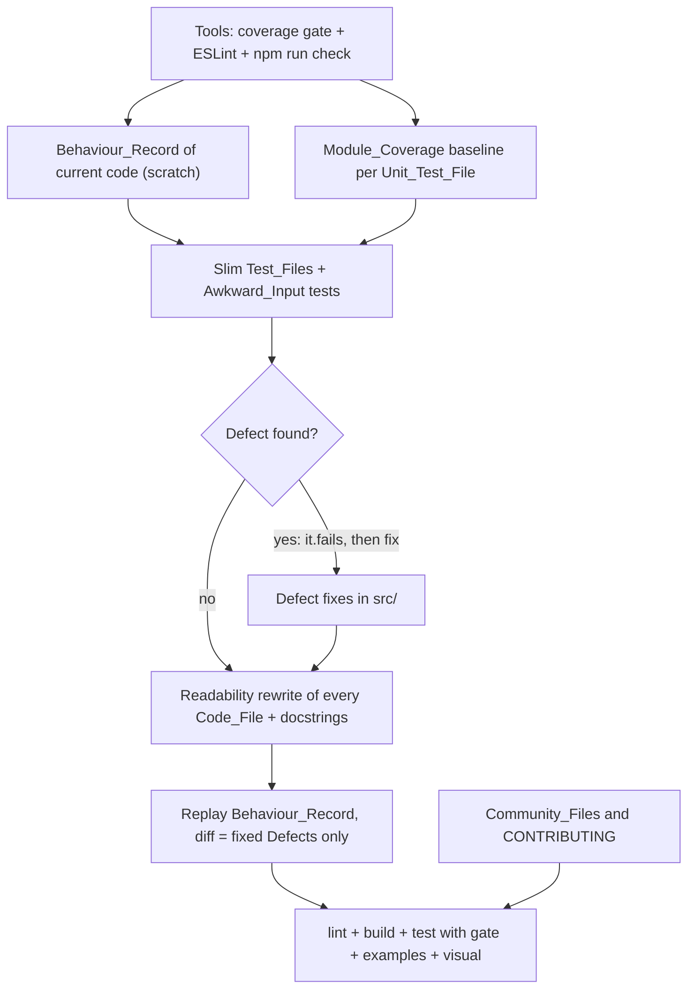
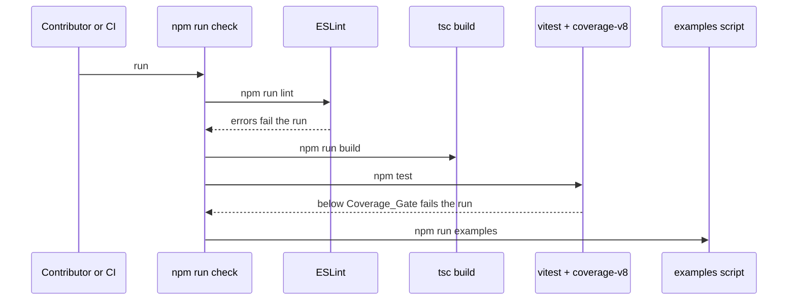

# Design Document

## Overview

The pass runs in a fixed order so that each step is guarded by the one before it. First the tools arrive: coverage through `@vitest/coverage-v8`, always on in `npm test` with a gate at today's numbers, and ESLint with TypeScript and docstring rules behind `npm run lint`. Then a Behaviour_Record captures what every exported function and CLI command does today. Then the tests are slimmed file by file against per-module coverage, and the Awkward_Input tests are added, marking any Defect as an expected failure. Then each Defect is fixed. Then every Code_File is rewritten to read plainly, the Behaviour_Record is replayed to prove nothing moved, and the docstrings and lint pass are completed. The community files are written alongside, since they touch no code. A single `npm run check` runs what CI runs, so a contributor, CI and the release workflow all fail the same way.

## Architecture

Key decision: coverage is always on in `npm test`, with the gate in `vitest.config.ts`. This follows the house setup the author pointed to, where Make, the hook and CI call the same script so the config file is the single gate (Requirements 1.2, 1.4). The trade-off is a slightly slower test run for every contributor, which is small for a suite that runs in seconds.

Rejected alternative: a separate `npm run coverage` script with the gate only in CI. A contributor could pass `npm test` locally and fail CI, which is what Requirement 1.4 rules out.

Key decision: the Coverage_Gate measures `src/` only. It starts at the percentages measured before any test changes, rounded down: 91% of lines and 83% of branches on today's suite (Requirement 1.3). Once the tests are slimmed and the Defects fixed, tests are added for uncovered Paths until `src/` reaches 95% of lines and 90% of branches and no module is below 90% and 85%, and the gate is raised to the result, rounded down (Requirements 1.7, 1.8). Today the gaps are branches in `style.ts` (70%) and `layout.ts` (77%), and lines in `cli.ts` (85%), `compile.ts` (87.5%) and `style.ts` (87.5%). Scripts, guide examples and the CLI's entry block run in child processes that in-process V8 coverage cannot see, so including them would only lower the number without measuring anything. `src/types.ts` holds only types and is excluded. The CLI's entry block, which runs only when the file is the started process, carries a `/* v8 ignore */` comment stating that reason, the one coverage exclusion in `src/` (Requirement 1.9).

Key decision: Module_Coverage is measured by `scripts/module-coverage.js <module>`, which runs the module's Unit_Test_Files alone with coverage limited to that one file and the gate switched off (Requirement 1.5). A script, rather than a documented `npx vitest` line, holds the mapping below in one place, since `template.ts` is tested through `engine` and `style.ts` has no file of its own today.

| Source_Module | Unit_Test_Files that measure it |
|---|---|
| `src/cli.ts` | `test/cli.test.ts` |
| `src/compile.ts` | `test/compile.test.ts` |
| `src/engine.ts` | `test/engine.test.ts`, `test/template.test.ts` (the template syntax suite runs through `renderTemplate`, a one-line wrapper) |
| `src/template.ts` | `test/template.test.ts` |
| `src/layout.ts` | `test/layout.test.ts` |
| `src/style.ts` | `test/style.test.ts`, new |
| `src/index.ts`, `src/types.ts` | none: re-exports and types only |

Key decision: a new `test/style.test.ts` takes over the tone and style tests now spread across `compile.test.ts` and `layout.test.ts`, so `style.ts` gets its own Unit_Test_File as Requirement 3.7 assumes. Its Module_Coverage before the change is measured with `compile.test.ts` and `layout.test.ts`, where those tests live today.

Key decision: ESLint 10 with a flat `eslint.config.js`, `@eslint/js` recommended, `typescript-eslint` recommended (not type-checked), `eslint-plugin-jsdoc` for the docstring rule, and `globals` for Node globals in `.js` and `.mjs` files (Requirements 2.1, 2.2). The docstring rule applies `jsdoc/require-jsdoc`, `require-param`, `require-returns` and their description rules to exported functions and classes in `src/` only. Thrown errors are written as `@throws` by hand, because no rule can infer them. New dev dependencies use `^` ranges, as the rest of `package.json` does.

Rejected alternative: the docs-only ESLint config from the `dansabin` project. It checks docstrings but nothing else, and the author asked for a real linter. Rejected alternative: type-checked typescript-eslint rules. They need a project service across `.js`, `.mjs` and test files with different tsconfig coverage, and their extra findings are mostly covered by `tsc --strict` already.

Key decision: the Behaviour_Record is a scratch script in the session scratchpad, never in the Repository (Requirements 7.1 to 7.3). It imports the built `dist/` (so it records exactly what users get), runs every Public_Contract and CLI command over fixed inputs, and writes one JSON file, with error messages recorded as values. It also hashes every file `npm run examples` writes and each guide script's output. Recorded against the code before any `src/` change (including Defect fixes), replayed after the rewrite, and diffed with `diff`.

Key decision: Defects are fixed in this pass, as the author asked ("we will find and fix everything in one pass"). Each Defect is first committed as an `it.fails` test (Requirement 4.4), then fixed in its own commit that flips the test (Requirement 5.1). A Defect that lets input inject markup, script or CSS is held for a private advisory, per the repository's security practice (Requirement 5.3).

Key decision: community files follow the best of the Handbook and common practice (Requirement 8.6).
- **Taken from the Handbook:** the YAML issue forms with `config.yml`, the SECURITY wording around private vulnerability reporting, the CONTRIBUTING sections on branch naming, issues and labels, and Contributor Covenant 2.1. This repository's code of conduct is the older 1.4.
- **Kept from this Repository:** its pull request template, the same shape as the Handbook's, and its release process, version tags with provenance.
- **Added from common practice, which the Handbook lacks:** a response time and supported-versions table in SECURITY, SUPPORT, CODEOWNERS, Dependabot, and least-privilege `permissions` in every workflow.
- **Files at GitHub's defaults:** new community files live in `.github/`. README, LICENSE, CONTRIBUTING and CODE_OF_CONDUCT stay at the root, where they are linked from today.

Rejected alternatives: pinning actions to commit SHAs and adding a CHANGELOG. Both were offered and not taken. Releases already carry generated notes, and Dependabot will keep the tag pins current.

## Components and Interfaces

### Coverage setup

| Operation | Where | Output | Requirements |
|---|---|---|---|
| `npm test` | `vitest.config.ts` `test.coverage`: `enabled: true`, `provider: 'v8'`, `include: ['src/**']`, `exclude: ['src/types.ts']`, `thresholds: { lines, branches }` | test results, coverage table, non-zero exit below the gate | 1.1, 1.2, 1.3, 1.4 |
| `npm run coverage:module -- <module>` | `scripts/module-coverage.js` | that module's line and branch coverage from its Unit_Test_Files alone | 1.5, 3.7, 9.1 |
| ignore output | `.gitignore` `/coverage` | none | 1.6 |

### Lint setup

| Operation | Where | Output | Requirements |
|---|---|---|---|
| `npm run lint` | `eslint.config.js`: ignores `dist`, `coverage`, `examples/out`, `test-results`; recommended JS and TS rules on all Code_Files; jsdoc rules on `src/**` exports; in `src/`, named declared exports only (no default exports and no local `export { name }` lists, which the jsdoc rules cannot fully check; re-exports with `from` stay allowed) | zero errors and warnings or a failing exit | 2.1, 2.2, 2.4, 2.5 |
| CI step | `.github/workflows/ci.yml`, `npm run lint` before build and test | failing job on lint errors | 2.3 |
| `npm run check` | `package.json`: `npm run lint && npm run build && npm test && npm run examples`, all offline; `npm run audit` and `npm run test:package` need the network and run in CI and by hand | one offline command; CI adds the audit, the packed-package check and the macOS visual job | 8.3 |

### Test support

| Operation | Where | Requirements |
|---|---|---|
| `AWKWARD_INPUTS` | `test/support/awkward-inputs.ts`: the named set (family emoji, flag emoji, non-Latin script, 10,000 characters, surrounding whitespace, whitespace only, zero-width joiner, a control character, a byte order mark) | 4.1 |
| `expectCleanOutcome(run)` | same file: asserts a call returns, or throws an `Error` with a message that is not a `TypeError` or `RangeError`, within 1 second | 4.2, 4.3 |
| temp directory and console capture | `test/support/`: one helper each, used by the CLI, guide and package tests instead of copies | 3.4, 3.5 |

### Parsing_Units and their Awkward_Input tests

| Parsing_Unit | Entry point the test calls | Test_File |
|---|---|---|
| CLI arguments | `parseArgs(argv)` with each input as a positional, a `--css` value and an unknown flag | `test/cli.test.ts` |
| JSON data file | `main([... '--data', file])` with each input written into a JSON string value and as raw file content | `test/cli.test.ts` |
| Template text and slot names | `compileTemplate(input)` and rendering with each input as data and as a slot | `test/engine.test.ts` |
| Layout tag attributes and sizes | `renderResponsiveLayout` with each input as an attribute value, a `size`, and tag content | `test/layout.test.ts` |
| Style attributes read back from HTML | `applyEmailStyle` with each input as a `data-ie-variant` and a tone colour | `test/style.test.ts` |

### Readability rewrite

Every Code_File is in scope: the eight Source_Modules, `scripts/*.js`, `examples/guides/*/*.mjs` with their guide pages, every Test_File and helper, and `vitest.config.ts`, `playwright.config.ts` and `eslint.config.js` (Requirements 6.1 to 6.9). The work is per file, by the rules of Requirement 6. Known candidates from reading the code:
- `compile.ts`: the conditional resource-inlining ternary in `inlineEmailHtml`, and the `Object.fromEntries(...filter)` in `engine.ts`.
- `layout.ts`: `renderImage`'s nested template-literal conditionals.
- `style.ts`: the two near-identical `replace` callbacks and `readStyleValue`'s optional chain.
- `cli.ts`: `options.css.pop()` mutating parsed state.
- The `attrs` and `img` abbreviations.

The layout tag list `shouldRenderResponsiveLayout` uses becomes one internal named export of `src/compile.ts`, not re-exported from `src/index.ts`, so the leak check in `test/support/leaks.ts` imports it instead of keeping a copy (the author's choice in wave 2). Public_Contracts keep their names and signatures. The docstrings needed are new ones on `compileEmailTemplate`, `renderEmail`, `inlineEmailHtml`, `renderTemplate`, `renderResponsiveLayout`, `isTemplateData`, `applyEmailStyle`, `normalizeEscapeMode`, `parseArgs`, `main` and `BUILT_IN_TONES`. `compileTemplate` already has one.

### Community_Files

| File | Content | Requirements |
|---|---|---|
| `.github/SECURITY.md` | private vulnerability reporting link, supported versions (latest 4.x), first response within 7 days, coordinated disclosure after a fix ships | 8.1 |
| `.github/ISSUE_TEMPLATE/bug.yml`, `feature.yml`, `config.yml` | forms with version, Node version and reproduction fields; `blank_issues_enabled: false`; links to the security policy and `docs/` | 8.2 |
| root `ISSUE_TEMPLATE.md` | deleted; it names the wrong package, `@freethinkingit/inline-email` | 8.2 |
| `CONTRIBUTING.md` | set up, `npm run check`, lint, coverage and `coverage:module`, branch naming `<issue>-<slug>`, issues and labels, releases (kept) | 8.3 |
| `.github/SUPPORT.md`, `.github/CODEOWNERS`, `.github/dependabot.yml` | questions go to Discussions Q&A (the issue chooser links it; no question form); `* @sabind`; weekly npm and github-actions updates with grouped minor and patch | 8.4 |
| `CODE_OF_CONDUCT.md` | Contributor Covenant 2.1, keeping the `hello@freethinking.it` contact | 8.6 |
| `ci.yml` | `permissions: contents: read` | 8.5 |
| `release.yml` | moved to `actions/checkout@v7`, `actions/setup-node@v7` and `softprops/action-gh-release@v3`, the Node 24 versions, as the author chose; its existing `permissions` stay, and `package-manager-cache: false` keeps npm caching off in the publish job, as setup-node's trusted-publishing guide recommends | 8.5 |
| README Development and Quality sections | name `npm run check`, lint and the coverage gate | 8.3 |

Settings that are not files go to the author as `gh` commands (Requirement 8.8):
- enable private vulnerability reporting;
- create the labels;
- enable Discussions, which SUPPORT and the issue chooser link for questions.

## Data Models

The Behaviour_Record file, written to the scratchpad only:

| Field | Type | Notes |
|---|---|---|
| `case` | string | a stable name, such as `compileEmailTemplate/responsive-false` or `cli/--data-missing-field` |
| `input` | JSON | the arguments passed |
| `output` | JSON | the return value, or `{ error: <class name>, message }` |
| `files` | `Record<path, sha256>` | for examples and guide outputs |

Coverage report row per Unit_Test_File, kept in the report: module, tests before, tests after, lines before and after, branches before and after, uncovered branches with the deleted test that covered them (Requirements 3.7, 3.8, 9.1).

## Correctness Properties

### Property 1: Coverage never drops below the gate
*For any* state of the Repository after the tools task, `npm test` exits non-zero exactly when `src/` line or branch coverage is below the Coverage_Gate.
**Validates: Requirements 1.3, 1.4**

### Property 1b: Coverage meets the targets
*For any* Source_Module after the coverage task, its Module_Coverage is at least 90% of lines and 85% of branches, and `src/` as a whole is at least 95% of lines and 90% of branches.
**Validates: Requirements 1.7, 1.8**

### Property 2: Slimming keeps each module's coverage
*For any* Source_Module with a Unit_Test_File, its Module_Coverage of lines after the slimming is at least its Module_Coverage before, and every branch it loses is named in the report with the Redundant_Test that covered it.
**Validates: Requirements 3.7, 3.8**

### Property 3: Awkward_Input never crashes a Parsing_Unit
*For any* Parsing_Unit and any input in the Awkward_Input set, the call returns or throws a non-`TypeError`, non-`RangeError` `Error` with a message, within 1 second, once the Defects are fixed.
**Validates: Requirements 4.1, 4.2, 4.3, 5.4**

### Property 4: The rewrite changes no behaviour
*For any* case in the Behaviour_Record, the output recorded against the old code equals the output against the new code, except the cases of fixed Defects, each named.
**Validates: Requirements 6.8, 7.1, 7.2**

## Error Handling

| Condition | Category | Behaviour | Requirements |
|---|---|---|---|
| Coverage below the gate | GATE | `npm test` exits non-zero and prints the failing metric | 1.4 |
| Lint error or warning | GATE | `npm run lint` exits non-zero; CI stops before build | 2.3, 2.4 |
| A lint rule cannot be met without a contract change | EXEMPTION | an inline `eslint-disable-next-line <rule> -- <reason>`, listed in the report | 2.5 |
| Slimming drops a module's line coverage | REGRESSION | restore or rewrite a test until it is back; a lost branch is allowed only for a Redundant_Test and is named | 3.7, 3.8 |
| An Awkward_Input crashes, hangs or gives a wrong result | DEFECT | `it.fails` with a one-line note, then a fix that flips it | 4.4, 5.1 |
| A Defect allows injection | SECURITY | fix held, reported for a private advisory, not described in the PR | 5.3 |
| Behaviour_Record differs on a non-Defect case | REGRESSION | the rewrite of that function is undone or corrected until the diff is empty | 7.2 |
| A guide example changes without its page | DRIFT | `test/docs.test.ts` fails; the page is updated in the same commit | 6.9 |

## Testing Strategy

- **Property 1:** after the tools task, a scratch run with the gate raised one point above the measured value fails, and at the measured value it passes.
- **Property 1b:** `npm test` with the raised gate, and `npm run coverage:module` per module against the 90% and 85% floors.
- **Property 2:** `npm run coverage:module` for each module, before the first test change and after the last, recorded in the report table.
- **Property 3:** one test per Parsing_Unit iterating `AWKWARD_INPUTS` through `expectCleanOutcome`, in the module's Unit_Test_File. These are example-based, not generated, since the set is fixed by Requirement 4.
- **Property 4:** the Behaviour_Record recorded before any source change and replayed after the rewrite, its diff in the report.
- **Gates:** `npm run check` and `npm run test:visual` at the end of every wave that changes code, plus CI on the pull request across Node 22, 24 and 26.
