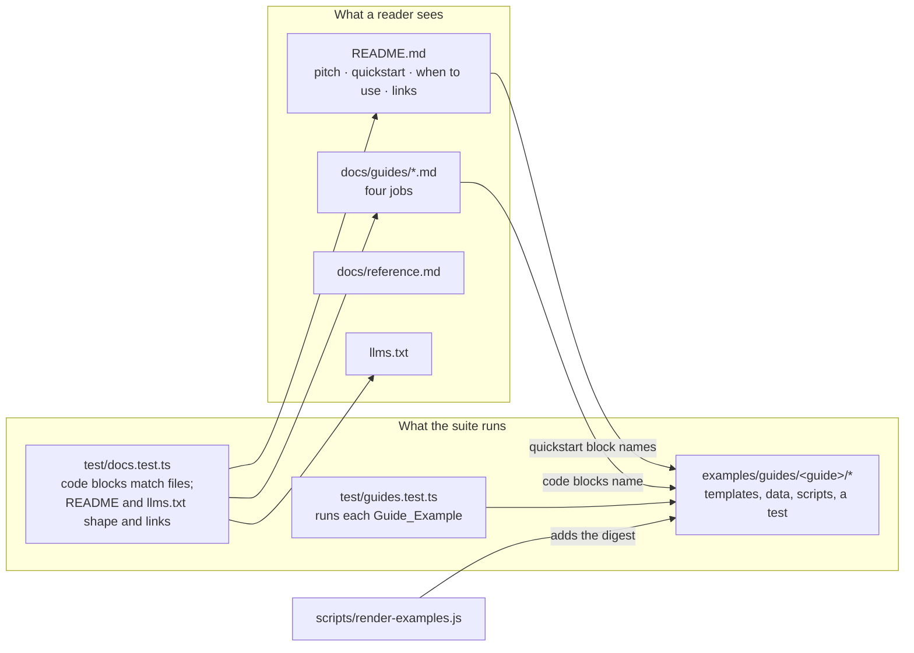
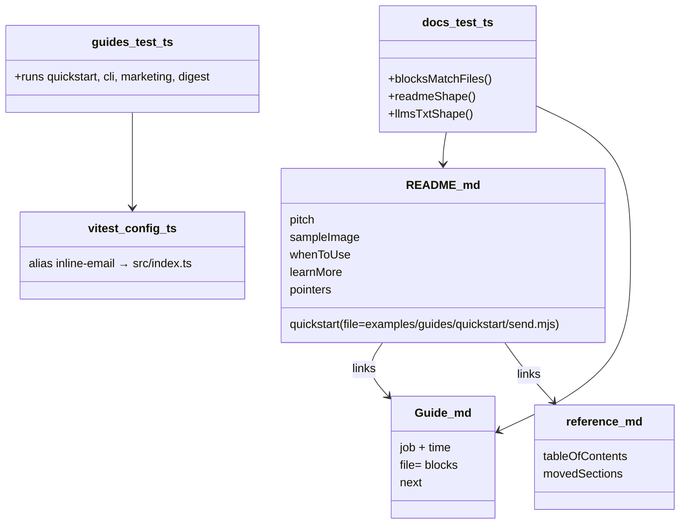

# Design Document

## Overview

The README becomes a short introduction, the detail it carried becomes `docs/reference.md`, four guides under `docs/guides/` each teach one job, and every piece of code a guide shows is a real file under `examples/guides/` that the test suite runs. Two small tests keep the documents honest: one asserts that each code block in a guide is byte-identical to the file it names, the other asserts the README's and `llms.txt`'s shape and that every link they make resolves. Package and GitHub metadata are aligned to 4.0, with the GitHub settings applied by `gh` commands the author runs. No file under `src/` changes and no dependency is added.

## Architecture



**Key decision: guide code lives in files the suite runs, and the pages quote the files.** Each guide's templates, CSS, sample data and scripts live under `examples/guides/<guide-name>/`. A guide page shows a file with a fenced block whose info string names it, for example ```` ```html file=examples/guides/transactional/welcome.html ````; GitHub renders the first word as the language and ignores the rest. `test/docs.test.ts` reads every guide, finds every block with a `file=` marker, and asserts the block's body equals the file's content. A guide can therefore only show code that exists, and editing the file without the page fails the suite (Requirements 2.2, 2.7). Trade-off: a doc edit means editing two places, the file and the page, with the test as the reminder; the alternative, generating pages from files, needs a build step and a generated-file convention the repository does not have.

*Rejected:* a script that regenerates guide pages from the example files. It removes the double edit but adds a generator, a "do not edit" header and a CI check that the generated output is committed, more machinery than four pages justify.

**Key decision: guide scripts import `inline-email` by name, resolved two ways.** The scripts a reader copies should say `import { compileEmailTemplate } from 'inline-email'`, not a relative path into `src/`. Under vitest a `vitest.config.ts` aliases `inline-email` to `./src/index.ts`, so the guide tests run against the source like every other test (Requirements 2.3, 6.2). Run with plain `node`, the same scripts resolve through Node's package self-reference, which the root `package.json` already allows through its `exports` field, so after `npm run build` a reader can run any guide script from a checkout unchanged. Trade-off: one new config file, `vitest.config.ts`, with a single alias; vitest is already installed, so no dependency is added.

*Rejected:* relative imports such as `../../../src/index.ts` in the guide files. They run without configuration but every reader would have to rewrite the import line, which defeats copying.

**Key decision: the transactional guide's test is the guide's own content.** The guide teaches strict mode in tests, so its example includes a vitest file, `examples/guides/transactional/welcome.test.ts`, that compiles the template with `strict: true`, renders it with complete data, and asserts that rendering with a field missing throws. Vitest's default include pattern collects any `*.test.ts`, so the file runs with the suite as it stands, and the page shows it with a `file=` block (Requirements 2.1, 2.3). The other guides' examples are exercised from `test/guides.test.ts`.

**Key decision: the CLI guide's commands are run through `main()`.** `test/guides.test.ts` calls the CLI's exported `main` with the same arguments the guide shows, capturing `console.log` as `test/cli.test.ts` already does, and asserts the rendered output; the guide's shell block and the test's argument list name the same files (Requirement 2.4). Trade-off: the test does not spawn a shell, so a difference between `node dist/cli.js` and `main` would not show; `test/cli.test.ts` already relies on the same shortcut.

**Key decision: the README is restructured around its first screen and capped by a test.** After the badges come the Pitch paragraph in the author's words, a single line of links to the four guides, the reference and `MIGRATION.md`, one Sample_Image, the "when to use it" list naming MJML, React Email and juice, and then the Quickstart as `file=` blocks of `examples/guides/quickstart/welcome.html` and `send.mjs`. A reader can decide, and find every page, before scrolling through the Quickstart's 43 quoted lines (Requirements 1.1 to 1.6). The sections moved to the reference each leave a one-line pointer under their old heading (Requirement 1.8). `test/docs.test.ts` asserts the README is at most 220 lines, that each required link is present and resolves to a file, and that `llms.txt` is at most 60 lines with every link resolving (Requirements 1.7, 5.2, 5.3). Trade-off: a line cap in a test can annoy a future editor; it is the only mechanism that keeps the README an introduction once this work is forgotten.

*Rejected:* keeping every section and only reordering. The reader still faces 490 lines, and the line cap, the one durable guarantee, cannot exist.

**Key decision: the digest guide adds a new example to the gallery.** `examples/guides/digest/digest.html` renders a table of at least ten rows from an array with `{{#each}}`, `@index`, `{{#if}}` for an empty state and a `formatNumber` helper; `scripts/render-examples.js` gains an entry for it so `npm run examples` and the served gallery show it (Requirement 2.5). Trade-off: the render script carries the data inline for the existing examples; the digest's data lives in `examples/guides/digest/data.json` and the script reads that file, the first example to do so.

**Key decision: GitHub metadata changes are commands the author runs.** The GitHub description, topics and homepage live in repository settings, not in a file, so the task list records the exact `gh repo edit` commands with their values, and the implementing run asks the author to run them and confirm (Requirements 4.1 to 4.4). `package.json`'s `description`, `keywords` and `homepage` change in the branch.

**Key decision: `llms.txt` is a hand-written page, checked for shape and links.** It follows the convention's shape: an H1, a summary paragraph, then sections of `- [title](url): description` lines pointing at the README, each guide, the reference, `MIGRATION.md` and the npm page, with absolute GitHub URLs so it reads the same from npm, GitHub or a fetched copy. It is listed in `package.json` `files` (Requirement 5). The docs test checks its length and that each repository link resolves; it does not fetch the npm URL.

## Components and Interfaces



### `README.md` (rewritten)

| Part | Content | Requirements |
|---|---|---|
| Pitch | the author's wording from the requirements, one paragraph | 1.2 |
| Links | one line linking the four guides, `docs/reference.md`, `MIGRATION.md` | 1.6 |
| Sample_Image | `docs/assets/feature-roundup.png`, the current lead image | 1.5 |
| When to use it | four bullets: the Library, then MJML, React Email, juice, each one sentence | 1.4 |
| Quickstart | install line, then `file=` blocks for `examples/guides/quickstart/welcome.html` and `send.mjs`, then the printed result | 1.3 |
| Examples | the other three Sample_Images in a table, `npm run examples`, the two integration scripts | 1.5 |
| Pointers | one line each for Library API, Template Syntax, Responsive Layout Tags, Compile Transforms, CLI, pointing into the reference | 1.8 |
| Kept | Status, Quality (shortened), Development, Release, What This Does Not Do, License | 1.7 |

### `docs/guides/<name>.md` (four new pages)

| Guide | Teaches | Guide_Example files | Requirements |
|---|---|---|---|
| `transactional.md` | compile a welcome email with a slot for a trusted summary, render per user, lock it with `strict: true` in a vitest test | `welcome.html`, `shared.css`, `send.mjs`, `welcome.test.ts` | 2.1, 2.3 |
| `cli-preview.md` | write a template and `data.json`, run `inline-email --data --strict --out`, open the preview, iterate | `email.html`, `email.css`, `data.json` | 2.1, 2.4 |
| `marketing.md` | helpers (`shout`, a `SafeString` badge), a `signature` partial, `webResources.images` embedding a local logo, `strict` on the resource fetch | `launch.html`, `logo.png` (a new PNG under 5 KB), `send.mjs` | 2.1, 2.3 |
| `digest.md` | a weekly digest from an array of at least ten rows: `{{#each}}` with `@index` and `@last`, `{{#if}}` empty state, `{{#unless}}`, a `formatNumber` helper, tones per row | `digest.html`, `data.json`, `send.mjs` | 2.1, 2.3, 2.5 |

Each page: title, one sentence on the job and the time, the files in reading order with `file=` blocks and prose between, the command or test to run and its output, a closing "next" line (Requirement 2.6).

### `docs/reference.md` (new)

Table of contents, then the moved README sections in this order: Library API (with `juice.webResources`), Template Syntax (Escaping, Slots, Strict Mode, Helpers, Partials and Engine Options), Responsive Layout Tags (with Vanilla Tones and Image-Based Open Analytics), Compile Transforms, CLI. Content moves verbatim; only cross-links and the opening sentence of each section change (Requirements 3.1 to 3.4).

### `examples/guides/` (new tree)

```
examples/guides/
  quickstart/   welcome.html  send.mjs
  transactional/ welcome.html  shared.css  send.mjs  welcome.test.ts
  cli-preview/  email.html  email.css  data.json
  marketing/    launch.html  logo.png  send.mjs
  digest/       digest.html  data.json  send.mjs
```

Scripts print the rendered `{ subject, html, text }` as JSON to stdout so the test can parse it. `logo.png` is a new image under 5 KB so the embedded data URI stays small; `.gitignore` ignores paths named `assets`, so no guide directory is named that.

### `test/guides.test.ts` (new)

| Test | Runs | Asserts | Requirements |
|---|---|---|---|
| quickstart | `send.mjs` via `node` child process, after the suite's usual build | stdout parses as JSON with `subject`, `html`, `text`; the html contains the rendered name and the slot's HTML and no `{{` | 1.3, 2.3 |
| cli-preview | `main([email.html, '--css', email.css, '--data', data.json, '--strict'])` with `console.log` captured; then the same with a data file missing a field | output contains the rendered values; the strict run rejects with `not defined` | 2.4 |
| marketing | `send.mjs` via `node` | html contains `data:image/png;base64`, the shouted text, the badge markup unescaped, the partial's text | 2.3 |
| digest | `send.mjs` via `node` | html has at least ten rendered rows, the formatted total, and the empty-state block absent; a second render with an empty array shows the empty state | 2.3, 2.5 |

The `node` child-process runs depend on `dist/` the way `test/esm-package.test.ts` already does; `npm test` in CI runs after `npm run build`.

### `test/docs.test.ts` (new)

| Test | Asserts | Requirements |
|---|---|---|
| guide blocks match files | for every `docs/guides/*.md` and the README, each fenced block with `file=<path>` equals the file's content exactly | 2.2, 2.7, 1.3 |
| README shape | at most 220 lines; links to the four guides, `docs/reference.md` and `MIGRATION.md` appear within the first 60 lines after the last badge line; every relative link resolves to a file | 1.1, 1.6, 1.7 |
| reference shape | `docs/reference.md` starts with a table of contents whose anchors match its headings; its CLI options block equals `usage()` from `src/cli.ts` line for line | 3.3, 3.4 |
| llms.txt shape | H1 first line, at most 60 lines, every relative or repository link resolves | 5.1, 5.3 |

### `vitest.config.ts` (new)

```ts
import { defineConfig } from 'vitest/config';
import { fileURLToPath } from 'node:url';

export default defineConfig({
  resolve: { alias: { 'inline-email': fileURLToPath(new URL('./src/index.ts', import.meta.url)) } }
});
```

### `scripts/render-examples.js` (changed)

One entry added for the digest, reading `examples/guides/digest/data.json`, under a new "Guides" category (Requirement 2.5).

### Metadata

| Field | Value | Requirements |
|---|---|---|
| `package.json` `description` and GitHub description | "Compile HTML and CSS into email-safe templates and render them with Handlebars per send. Node library and CLI." | 4.1 |
| `package.json` `keywords` and GitHub topics | `email`, `html-email`, `email-templates`, `transactional-email`, `handlebars`, `juice`, `css-inlining`, `responsive-email`, `cli`; topics also drop `convert-html-files` and `inky` | 4.2 |
| `package.json` `homepage` and GitHub homepage | `https://github.com/freethinkingit/inline-email#readme` | 4.3 |
| `package.json` `files` | adds `llms.txt` | 5.3 |

GitHub commands for the author (Requirement 4.4):

```sh
gh repo edit --description "Compile HTML and CSS into email-safe templates and render them with Handlebars per send. Node library and CLI." --homepage "https://github.com/freethinkingit/inline-email#readme"
gh repo edit --add-topic handlebars --add-topic transactional-email --add-topic email-templates --add-topic juice --add-topic css-inlining --remove-topic convert-html-files --remove-topic inky
```

## Data Models

`examples/guides/*/data.json` files are plain template data for `render()`; the digest's shape:

| Field | Type | Notes |
|---|---|---|
| `workspaceName` | string | heading |
| `periodLabel` | string | subheading |
| `total` | number | formatted by the `formatNumber` helper |
| `rows` | array of `{ title, owner, count, tone, done }` | at least ten entries (Req 2.5); `tone` is one of the five vanilla tones; `done` drives `{{#if}}` |

A guide page's `file=` marker: the info string is `<lang> file=<path from repository root>`; the path must exist and the block body must equal the file's bytes with a single trailing newline tolerated.

## Correctness Properties

### Property 1: Guides show real files

*For any* fenced block in the README or a guide that carries a `file=` marker, the block's body equals the content of the named file.

**Validates: Requirements 1.3, 2.2, 2.7**

### Property 2: Guide examples render clean

*For any* Guide_Example template rendered with its sample data, the output contains no `{{` sequence and no unexpanded layout tag, the same invariant `test/examples.test.ts` holds for the gallery examples.

**Validates: Requirements 2.3, 2.5**

### Property 3: Every documentation link resolves

*For any* relative link in the README, a guide, the reference or `llms.txt`, the target file exists in the repository.

**Validates: Requirements 1.6, 3.3, 5.2**

## Error Handling

| Condition | Category | Behaviour | Requirements |
|---|---|---|---|
| a guide block differs from its file | DRIFT | `test/docs.test.ts` fails naming the guide, the file and the first differing line | 2.2, 2.7 |
| a `file=` path does not exist | DRIFT | the same test fails naming the path | 2.2 |
| README exceeds 220 lines or lacks a required link | SHAPE | the same test fails naming the limit or the missing link | 1.6, 1.7 |
| `llms.txt` exceeds 60 lines or a link does not resolve | SHAPE | the same test fails | 5.3 |
| reference CLI block drifts from `usage()` | DRIFT | the same test fails | 3.4 |
| a guide script's render throws or leaks a placeholder | BEHAVIOUR | `test/guides.test.ts` fails with the script's stderr | 2.3 |
| `dist/` missing when the child-process tests run | ENVIRONMENT | the guide test fails with Node's module-not-found error; `npm run build` first, as for `test/esm-package.test.ts` | 2.3 |
| GitHub metadata command fails or is not run | MANUAL | the task list's hand-run step stays unticked and the report says so | 4.4 |

## Testing Strategy

- **Property 1** is `test/docs.test.ts`'s block check over every guide page and the README; no generation is involved, the markers are the table.
- **Property 2** is `test/guides.test.ts` running each Guide_Example through `node` or `main()` and applying the two regexes from `test/examples.test.ts`.
- **Property 3** is the link check in `test/docs.test.ts`, applied to the README, the four guides, the reference and `llms.txt`.
- **Error rows:** a deliberately altered block, a missing path and a 221-line README are each exercised once in `test/docs.test.ts` through small in-memory fixtures of the checker, so the checker itself is tested, not only the documents.
- **Integration:** `npm run examples` renders the digest into the gallery; `npm run test:visual` is run once to confirm the five existing snapshots are untouched (the digest has no snapshot; adding one is out of scope).
- **Manual:** the author runs the two `gh repo edit` commands and `gh repo view` shows the new description, homepage and topics.
