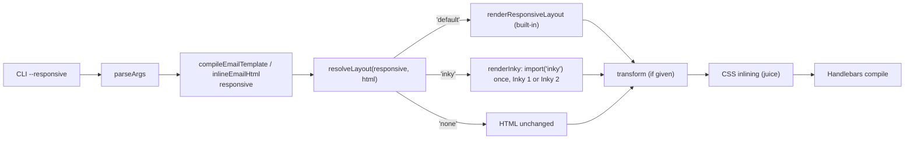

# Design Document

## Overview

The layout step of the compile pipeline becomes a lookup by name. The `responsive` value, from the library or the CLI, is normalized once at the boundary into a Resolved_Layout: `'default'`, `'inky'` or `'none'`. The Resolved_Layout selects one function from a small Flavor_Table, and that function runs before the Transform and CSS inlining, as the Built_In_Layout does today. `'default'` maps to the existing `renderResponsiveLayout`. `'inky'` maps to a new loader that imports the caller's installed Inky, version 1 or 2, on first use and runs it. Inky is not a dependency of any kind, so nobody who does not ask for it installs or loads it. Every value that exists today normalizes to the same layout it selects today, so their output does not change.

Inky 1.5.0 was checked in a scratch install on 2026-10-22, outside the repository:

- `import { Inky } from 'inky'` works from an ES module.
- `releaseTheKraken` renders `<container>`, `<row>`, `<columns>`, `<button>` and `<spacer>` to tables.
- It leaves `{{firstName}}`, `href="{{appUrl}}"` and `{{#items}}...{{/items}}` untouched.
- On Node 24 it prints `DEP0060 DeprecationWarning: util._extend` once per process.
- Its install brings about 330 packages and 24 MB, among them `vinyl-fs`, `cheerio@0.20` and `foundation-emails`. In a clean project it is 210 packages with 10 `npm audit` findings, 2 of them critical.

Inky 2.0.0-beta.10 was checked the same day:

- It is one package with a 3.4 MB WASM file, no dependencies and no `npm audit` findings, and it ships TypeScript types.
- It exports `transform(html)`, which accepts Inky 1 markup such as `<columns small="12" large="6">` and adds `role="presentation"` to its tables.
- It rewrites the Handlebars partial `{{> footer}}` as `{{&gt; footer}}`, and Handlebars then fails with `Parse error on line 1:`. Inky 1, and today's pipeline, keep `{{> footer}}`.

## Architecture

**Key decision: one Flavor_Table keyed by name.** The layout step is chosen by looking up the Resolved_Layout in a `Record<LayoutFlavor, (html) => Promise<string>>`, and the Transform runs on its result in every case (Requirements 1.1, 1.5, 2.1). Adding a flavor later is one entry in the table, one member of the `LayoutFlavor` type and one accepted CLI value, which is the room for extension the author asked for. The trade-off is that flavors do not mix: one compile runs one layout, so Layout_Tags under `'inky'` pass through unrendered (Requirement 4.4).

**Key decision: normalize every value once, at the boundary.** A single `resolveLayout` function turns the Responsive_Option into a Resolved_Layout before anything runs. `true`, `{ enabled: true }` and `'default'` resolve to `'default'`. `false` and `{ enabled: false }` resolve to `'none'`. Left out, `null` and `{}` resolve by today's Layout_Tag detection. `'inky'` resolves to `'inky'`. Anything else throws (Requirements 1.2, 1.3, 1.4). The trade-off is that a JavaScript caller who passes an unrecognized value, such as the string `'true'` or `{ enabled: 'yes' }`, gets an error in 4.1.0 where 4.0.2 silently auto-detected or treated it as truthy. That is the one observable change for input that was already wrong, and the PR and release notes say so. `null` is kept as "left out" because `responsive: config.value ?? null` is a plausible pattern and failing it would break valid-looking code.

**Key decision: Inky is the caller's own install, loaded on first use.** `package.json` declares no peer dependency on Inky: an optional peer range makes npm refuse to install inline-email next to an Inky version outside it (`ERESOLVE`, checked 2026-10-22 with `inky@2.0.0-beta.10` against `^1`). The tests use `inky@^1.5.0` and, under the alias `inky-2`, `npm:inky@2.0.0-beta.10`, both as devDependencies (Requirements 2.6, 2.7, 5.2). The loader imports `inky` with a dynamic `import()` the first time an `'inky'` compile runs and caches the module promise, so a process that never asks for Inky never loads it. The trade-off is that npm shows no supported Inky range, so the loader checks what it found (Requirement 2.8), and that Inky 1's own Node 24 deprecation warning is printed once in processes that use it. The audit script runs with `--omit=dev`, so Inky 1's old dependency tree does not affect `npm run audit`.

**Key decision: no fallback when Inky is missing.** `'inky'` without Inky throws an error naming the package and `npm install inky` (Requirement 2.4). Falling back to `'default'` would render Inky_Markup with the Built_In_Layout, which is the broken-table bug this change exists to remove.

**Key decision: detect the Inky version by what the package exports.** Inky 1 exports an `Inky` class, and `renderInky` calls `new Inky().releaseTheKraken(html)`. Inky 2 exports a `transform(html)` function, and `renderInky` calls it. When a module exports both, `transform` wins: Inky 1 never exports it, so its presence means Inky 2. Both accept Inky 1 markup (checked 2026-10-22). Detecting the export rather than reading a version number keeps working across Inky 2 betas that keep `transform` (Requirements 2.1, 2.8).

**Key decision: reject Inky 2 with partials, before Handlebars does.** Inky 2.0.0-beta.10 rewrites `{{> footer}}` as `{{&gt; footer}}`, and Handlebars then fails with `Parse error on line 1:`. When Inky 2 is in use and the HTML contains `{{>`, `renderInky` rejects with `Inky 2 escapes Handlebars partials ({{> name}}); Inky 1 keeps them. Use Inky 1 (npm install inky@1), or inline the partial.` A warning was rejected, because the compile fails anyway and the warning would arrive next to a parse error that hides it. Undoing the escaping after Inky 2 was rejected, because it patches another tool's output and could hide other escaping (Requirement 2.9).

**Key decision: `inlineEmailHtml` accepts the same values.** Its `responsive` option widens from `boolean` to `boolean | LayoutFlavor`, so the lower-level function and `compileEmailTemplate` agree (Requirement 1.1). Its object form is typed only on `compileEmailTemplate`; at runtime `inlineEmailHtml` resolves it the same way, so the two functions agree. For JavaScript callers of `inlineEmailHtml`, `null` and `{}` now detect layout tags and `{ enabled: false }` turns the layout off, where 4.0.2 treated `null` as off and any object as on; the PR notes this.

**Key decision: the CLI maps strings to library values.** `--responsive default|inky|false` sets the library's `'default'`, `'inky'` or `false`, and leaving the flag out passes nothing, so the CLI keeps today's detection (Requirement 3). `false` is spelled as the library spells it, so the docs need one vocabulary.

Rejected alternative: **document `responsive: false` with an Inky Transform.** This is what MIGRATION.md says today. It works, but every Inky user must know to turn the Built_In_Layout off and write the same Transform, and the CLI cannot do it at all. The author chose a named flavor instead.

Rejected alternative: **list Inky under `dependencies`.** Every install would carry about 330 packages for a feature most callers do not use, against the README's promise of few dependencies.

Rejected alternative: **a separate `layout` option.** It would mean two options that both choose the layout step and can contradict each other. The author asked for the name to go in `responsive`.

Rejected alternative: **Inky settings now.** 2.x passed `options.inky` to `new Inky(settings)`. This design constructs Inky with its defaults. Settings can arrive later as `{ flavor: 'inky', inky: {...} }` on the object form without changing anything here. The author left Inky settings out of the requirements.

## Components and Interfaces

### `src/types.ts` (changed)

Adds `export type LayoutFlavor = 'default' | 'inky'`. `CompileEmailTemplateOptions.responsive` becomes `boolean | LayoutFlavor | ResponsiveLayoutOptions`. `ResponsiveLayoutOptions` is unchanged. `LayoutFlavor` is exported from `src/index.ts`.

### `src/compile.ts` (changed)

`normalizeResponsiveOption` is replaced by `resolveLayout`, and `shouldRenderResponsiveLayout` and the layout half of `applyTransforms` are replaced by the Flavor_Table lookup. The `LAYOUT_TAG_PATTERN` detection is kept as it is.

| Operation | Input | Output | Requirements |
|-----------|-------|--------|--------------|
| `resolveLayout(responsive, html)` | any Responsive_Option value, the HTML | `'default'`, `'inky'` or `'none'`, or a thrown error for an unknown value | 1.1, 1.2, 1.3, 1.4 |
| `LAYOUT_FLAVORS[flavor](html)` | a LayoutFlavor, the HTML | the laid-out HTML | 1.1, 2.1, 2.2 |
| `applyTransforms(html, options)` | the HTML, the resolved layout, the Transform | the layout step's output passed through the Transform | 1.5 |
| `inlineEmailHtml(html, css, { responsive })` | `responsive: boolean \| LayoutFlavor` | inlined HTML | 1.1 |

### `src/inky.ts` (new)

Loads and runs Inky. It is the only module that names the `inky` package.

| Operation | Input | Output | Requirements |
|-----------|-------|--------|--------------|
| `renderInky(html)` | HTML with Inky_Markup | the installed Inky's table HTML; a rejection with Inky's error, for an unknown export, or for Inky 2 with a partial | 2.1, 2.3, 2.5, 2.8, 2.9 |
| `loadInky()` (internal) | none | the cached Inky module; a rejection naming `inky` and `npm install inky` when it is not installed, or saying it could not load `inky` when it is installed but fails | 2.4, 2.7, 2.10 |

The import uses a specifier held in a variable, such as `const INKY_PACKAGE = 'inky'`, so TypeScript does not need Inky's types, which Inky 1 does not ship, and the published `.d.ts` files never reference Inky. The two module shapes are typed locally: Inky 1 as `{ Inky: new () => { releaseTheKraken(html: string): string } }` and Inky 2 as `{ transform(html: string): string }`, each read from the module or its `default` export.

### `src/cli.ts` (changed)

`CliOptions` gains `responsive?: boolean | LayoutFlavor`. `parseArgs` reads `--responsive <value>` with `readValue`, maps `false` to `false`, and passes `default` and `inky` through. The value is passed to `compileEmailTemplate`. The help text gains a `--responsive` line.

| Operation | Input | Output | Requirements |
|-----------|-------|--------|--------------|
| `parseArgs(argv)` | argv with `--responsive <value>` | `options.responsive`, or a `CliError` naming the accepted values | 3.1, 3.2, 3.3 |
| `runCli(argv)` | parsed options | compiled output, or the Inky load error on stderr with exit status 1 | 3.1, 3.4 |
| `usage()` | none | help text listing `--responsive default\|inky\|false` | 3.5 |

### `package.json` (changed)

Adds `devDependencies.inky: "^1.5.0"` and `devDependencies["inky-2"]: "npm:inky@2.0.0-beta.10"`, declares no peer dependency, and sets `version` to `4.1.0` (Requirements 2.6, 5.1).

### Documentation (changed)

| File | Change | Requirements |
|------|--------|--------------|
| `README.md` | Adds the Inky line to "When to use it" | 4.1 |
| `docs/reference.md` | Responsive Layout Tags: the Combination_Table, `'default'` as the preferred spelling of `true`, and flavors not mixing. A new Inky subsection: install `inky`, set `responsive: 'inky'`, pass Foundation for Emails' CSS, and compare Inky 1 (stable, about 200 packages with known audit findings) with Inky 2 (beta, no dependencies, no partials). Compile Transforms: the Transform runs after the chosen flavor. CLI: `--responsive`. | 4.2, 4.3, 4.4, 4.6, 4.7 |
| `MIGRATION.md` | The 2.x prompt's rules 3 and 4 and the "Keep writing Inky" section say: install `inky` and set `responsive: 'inky'` on 4.1.0 or later. They drop the 2.x Inky-settings route, and say `'inky'` runs Inky 1 or Inky 2 with their defaults. They no longer tell the reader to use `responsive: false` with an Inky Transform, and they say the CLI takes `--responsive inky`. Rule 4's "the CLI has no switch" becomes `--responsive false`. | 4.5 |

The Foundation CSS ships with Inky's own dependency `foundation-emails`, at `foundation-emails/dist/foundation-emails.css`. That path is inferred from the package name and has not been opened, so the docs task confirms it before naming it.

## Data Models

The Responsive_Option's accepted values, and the Resolved_Layout each one maps to, are the Combination_Table in Requirement 1.

| Type | Values | Notes |
|------|--------|-------|
| `LayoutFlavor` | `'default' \| 'inky'` | Exported. Extending it is how a new flavor is added. |
| Resolved_Layout (internal) | `LayoutFlavor \| 'none'` | `'none'` skips the layout step. It is not a public value; `false` is. |
| `ResponsiveLayoutOptions` | `{ enabled?: boolean }` | Unchanged. A non-boolean `enabled` throws (Requirement 1.4). |
| Inky module (internal) | `{ Inky: new () => { releaseTheKraken(html: string): string } }` or `{ transform(html: string): string }`, on the module or its `default` | The parts of Inky 1's and Inky 2's APIs that are used. |

## Correctness Properties

### Property 1: Existing values are unchanged

*For any* HTML, CSS and options, compiling with `responsive` left out, `null`, `true`, `false`, `{}`, `{ enabled: true }` or `{ enabled: false }` produces output identical to 4.0.2's.

**Validates: Requirements 1.3, 3.2, 5.3**

### Property 2: `'default'` is `true`

*For any* HTML, CSS and options, compiling with `responsive: 'default'` produces output identical to compiling with `responsive: true`.

**Validates: Requirement 1.2**

### Property 3: Under `'inky'`, only Inky lays out

*For any* HTML compiled with `responsive: 'inky'`, the output contains no markup from the Built_In_Layout (no `ie-` classes and no `data-ie-preserve-style` block) and no `<container>`, `<row>` or `<columns>` tag.

**Validates: Requirements 2.2, 2.3**

### Property 4: Unknown values reject

*For any* `responsive` value outside the Combination_Table, compiling rejects with an error that names the value and lists `'default'`, `'inky'`, `true` and `false`.

**Validates: Requirement 1.4**

### Property 5: The Transform sees the layout's output

*For any* Resolved_Layout and Transform, the Transform receives exactly the HTML that layout step produced.

**Validates: Requirement 1.5**

### Property 6: Inky loads only on request

*For any* compile whose `responsive` is not `'inky'`, the `inky` package is not imported.

**Validates: Requirements 2.6, 2.7**

### Property 7: Either Inky renders

*For any* Inky_Markup without a partial, compiling with `responsive: 'inky'` gives the HTML that the installed Inky's own API returns for it, with Inky 1 and with Inky 2.

**Validates: Requirements 2.1, 2.8**

## Error Handling

| Condition | Category | Behaviour | Requirements |
|-----------|----------|-----------|--------------|
| `responsive` is an unknown string, a number, an array, or an object whose `enabled` is not a boolean | VALIDATION | Reject at compile time: `Unknown responsive value <value>. Use 'default', 'inky', true or false.` | 1.4 |
| `responsive: 'inky'` and `import('inky')` fails with `ERR_MODULE_NOT_FOUND` | MISSING_PEER | Reject: `responsive: 'inky' needs the inky package. Install it with npm install inky.` with the original error as `cause`. No fallback. | 2.4 |
| `responsive: 'inky'` and the import fails another way, such as a syntax error inside Inky | MISSING_PEER | Reject: `responsive: 'inky' could not load the inky package.` with the original error as `cause`. Node keeps a failed CommonJS load for the life of the process, so a fixed install needs a restart (checked 2026-10-22). | 2.10 |
| Inky throws in `releaseTheKraken` or `transform` | LAYOUT | Reject with Inky's error unchanged; no HTML is returned | 2.5 |
| The installed `inky` exports neither `Inky` nor `transform` | MISSING_PEER | Reject: `responsive: 'inky' supports Inky 1 and Inky 2; the installed inky package exports neither.` | 2.8 |
| Inky 2 and the HTML contains `{{>` | LAYOUT | Reject: `Inky 2 escapes Handlebars partials ({{> name}}); Inky 1 keeps them. Use Inky 1 (npm install inky@1), or inline the partial.` | 2.9 |
| `--responsive` with no value | CLI_USAGE | `CliError` from `readValue`; exit 1 | 3.3 |
| `--responsive` with a value other than `default`, `inky` or `false` | CLI_USAGE | `CliError: Unknown --responsive value <value>. Use default, inky or false.`; exit 1 | 3.3 |
| `--responsive inky` without Inky installed | MISSING_PEER | The library's error printed to stderr; exit 1 | 3.4 |

## Testing Strategy

The repository uses vitest with example tests and has no property-testing library, so properties are table-driven tests, as in earlier specs. Inky is a devDependency, so the Inky tests run the real Inky 1.

- **Property 1:** the existing `test/compile.test.ts` cases for `responsive` run unchanged. A table of the seven old values, crossed with an HTML string with a Layout_Tag and one without, asserts the same output as the corresponding existing case. No existing test's expected output is edited (Requirement 5.3).
- **Property 2:** for each example in `examples/` that uses Layout_Tags, compile with `'default'` and with `true` and assert equal HTML.
- **Property 3:** a table of Inky_Markup strings (container, row with columns, button, spacer, a mix with a Layout_Tag such as `<section>`, and one with Handlebars expressions) compiled with `'inky'`. Assert no Built_In_Layout markup, no Inky tags left, and the Handlebars expressions intact after `render`. Run the table with Inky 1 and with Inky 2, the latter through the `inky-2` alias (Property 7).
- **Property 4:** a table of `'true'`, `'Default'`, `'mjml'`, `''`, `1`, `[]` and `{ enabled: 'yes' }`. Each rejects with the message.
- **Property 5:** a recording Transform per Resolved_Layout asserts its input equals that layout step's output.
- **Property 6:** `vi.mock` of the `inky` specifier with a spy. Compiles with every non-`'inky'` value leave the spy uncalled.
- **Error rows:** the missing-peer row is simulated with `vi.doMock` making the import throw an `ERR_MODULE_NOT_FOUND` error, and asserts the message, the `cause` and that no fallback output is returned. The broken-install row makes the import throw a `SyntaxError` and asserts the could-not-load message and its `cause`. The Inky-throws row uses a mock whose `releaseTheKraken` throws. The unknown-export row uses a mock with neither `Inky` nor `transform`. The partials row compiles `{{> footer}}` with Inky 2. The CLI rows go in `test/cli.test.ts`.
- **Integration:** `npm run test:package` installs the packed package without Inky. It gains one check: `responsive: 'inky'` rejects with the install message, which proves the optional peer is not pulled in (Requirement 5.2). `test/docs.test.ts` keeps the docs' line limits and links passing.
- **Visual:** `npm run test:visual` must pass with no snapshot change, since no existing example changes.
