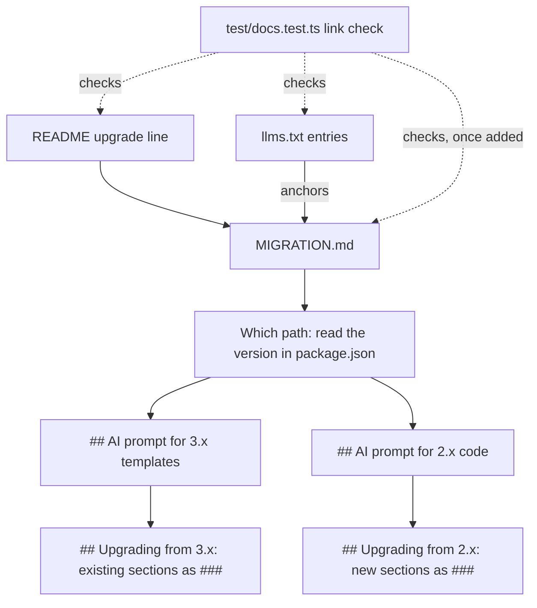

# Design Document

## Overview

`MIGRATION.md` becomes the one upgrade guide, for 2.x and 3.x to 4.x. It opens with a short "which path" paragraph, then the two Agent_Prompts, then the details for each path. The 3.x content is moved, not rewritten; the 2.x content is new, written from the `2.0.1` source and checked against the current build. The README loses its five Pointer_Sections and its two upgrade notes become one line. `llms.txt` gains an entry per path and per prompt. The wiki is turned off after the pull request merges. The existing docs tests carry most of the checking: they already resolve every link and anchor in the README and `llms.txt`.

## Architecture



The guide's outline, in order:

```text
# Migrating to v4
  intro: one paragraph per path, by the version in package.json; older than 2.x follows 2.x
## AI prompt for 3.x templates      (the current prompt, rules unchanged)
## AI prompt for 2.x code           (new)
## Upgrading from 3.x               (current sections, demoted from ## to ###)
### The engine … ### Data keys named like built-in helpers, ### Slots,
### CLI image default, ### The CLI fails on a malformed template,
### What stays the same from 3.x
## Upgrading from 2.x               (new)
### Node.js 22 and ESM
### lib/render becomes inlineEmailHtml
### The --inky flag and Inky markup
### Linked stylesheets are no longer read
### Images are not inlined by default
### Double braces are template syntax
### Styles in the HTML when --css is given
### What stays the same from 2.x
```

Key decision: keep the file at `MIGRATION.md` with its title. It is shipped in the npm package, listed in `llms.txt` and required by the README opening check; moving it would break all of those for no reader benefit (Requirements 1.1, 6.4).

Key decision: 3.x first, then 2.x, for both the prompts and the details. 3.x users are the larger and more recent group, and their prompt already exists; a 2.x reader is sent past it by the intro (Requirement 1.2). Trade-off: the order is not chronological.

Key decision: every heading in the guide has a unique slug. The docs test's `headingSlugs` does not add GitHub's `-1` suffix to repeated headings, so a second "What stays the same" could not be linked or checked; each path's version is named in its heading instead (Requirements 7.2, 7.3).

Key decision: the 2.x prompt converts usage, not templates. 2.x had no template syntax: a project uses it through CLI calls in scripts and through `require('inline-email/lib/render')`. The prompt asks for those, and treats any `{{` already in the HTML as a question, since 4.x reads it as Handlebars (Requirements 2.1, 2.5, 4.1).

Key decision: add `MIGRATION.md` to the docs link check. The check covers the README, guides, reference and `llms.txt` today but not the guide this change rewrites; adding it to the existing `it.each` list is a one-line test change (Requirement 4.2 support, 7.3).

Key decision: the README's five Pointer_Sections are removed with nothing in their place; the Docs_Line at the top already links the reference. The two upgrade notes become one line under the Docs_Line: "Upgrading from 2.x or 3.x? MIGRATION.md starts with a prompt you can paste into an AI assistant." (Requirements 6.1 to 6.4).

Rejected alternative: two files, `docs/migrations/v3.md` and `v4.md`. The author chose one guide; two files also double the links to keep in step.

Rejected alternative: chain 2.x → 3.x → 4.x. A 2.x reader would apply 3.x changes that 4.x then undoes; the author chose straight to 4.x.

## Components and Interfaces

| Component | Responsibility | Operation | Requirements |
|---|---|---|---|
| `MIGRATION.md` intro | Send the reader to a path | Name each path by the major version in `package.json`; older than 2.x follows 2.x | 1.1, 1.2, 1.5 |
| AI prompt for 3.x templates | Convert 3.x templates | The current prompt's text and ten rules, moved | 3.1, 3.2, 1.3 |
| AI prompt for 2.x code | Convert 2.x usage | Ask for scripts and `lib/render` calls; one rule per 2.x section; leave working code alone; return files, changes with rule numbers, questions; Inky tags listed with the nearest layout tag and asked about | 2.1 to 2.5, 1.3 |
| Upgrading from 3.x | 3.x details | Current sections, one level down, meaning unchanged | 5.1, 5.2, 1.4 |
| Upgrading from 2.x | 2.x details | One section per difference, before from `2.0.1`, after from the current build | 4.1 to 4.4, 1.4 |
| README | Short front page | Remove five Pointer_Sections and the wiki line; one upgrade line | 6.1 to 6.5 |
| `llms.txt` | Index for assistants | One entry for the guide, one per prompt anchor | 7.1, 7.2 |
| `test/docs.test.ts` | Keep links honest | Add `MIGRATION.md` to the link-check list | 7.3, 4.2 |
| Wiki | Retire | `gh api -X PATCH repos/freethinkingit/inline-email -f has_wiki=false` after merge | 8.1 to 8.3 |

## Data Models

The 2.x facts the details rest on, read from tag `2.0.1` and the current build:

| 2.x | 4.x | Source |
|---|---|---|
| Node 8 or later, CommonJS | Node 22 or later, `import` only | `2.0.1:package.json`, `package.json` |
| `require('inline-email/lib/render')(html, css, { inky, juice })` returns a promise | `inlineEmailHtml(html, css, { juice })` from `inline-email` | `2.0.1:lib/render.js`, `src/compile.ts` |
| `--inky`, `-i` preprocessed Inky | `Unknown option: --inky`, exit 1; layout tags or a `transform` | `2.0.1:bin/inline-email`, probe |
| With no `--css`, `<link rel="stylesheet">` was read and inlined | The link is left as is and its styles are not applied | probe |
| Images inlined unless `--noInlineImages` | Off; `--inlineImages` turns on; `--noInlineImages` ignored | `MIGRATION.md`, reference |
| `{{` was plain text | Template syntax; malformed throws in the CLI | `MIGRATION.md` |
| `--css` given: `<style>` blocks ignored | Left in place | 2.x README, reference; to confirm by run |

Each row becomes one ### section and one prompt rule. A row the run contradicts is corrected before writing, not written as above.

## Correctness Properties

### Property 1: Every example is real
*For any* "after" example in the Upgrading from 2.x section, running it against the current build gives the output shown; *for any* "before" example, the `2.0.1` source accepts it.
**Validates: Requirements 4.2, 4.3**

### Property 2: Every link and anchor resolves
*For any* link in the README, `llms.txt` or `MIGRATION.md`, the target file exists and the anchor names a heading in it.
**Validates: Requirements 6.4, 7.2, 7.3**

### Property 3: One rule per difference
*For any* ### section under Upgrading from 2.x other than "What stays the same from 2.x", the 2.x prompt has exactly one rule that names it.
**Validates: Requirements 2.2, 4.1**

### Property 4: The 3.x content is preserved
*For any* section or prompt rule in the current `MIGRATION.md`, the new guide holds the same text, apart from heading level and the 3.x "What stays the same" heading name.
**Validates: Requirements 3.1, 3.2, 5.1, 5.2**

## Error Handling

| Condition | Category | Behaviour | Requirement |
|---|---|---|---|
| A 2.x fact in the table is contradicted by a run | Content | Correct the section and its prompt rule to what the run shows | 4.2 |
| A 2.x behaviour has no 4.x equivalent | Content | Say so and name the nearest alternative | 4.4 |
| README structure check fails | Test | Adjust the README, not the check | 6.5 |
| An `llms.txt` anchor misses a heading | Test | Fix the anchor or the heading before done | 7.3 |
| A wiki link remains outside closed specs | Content | Remove it | 8.1 |
| The wiki is turned off before merge | Process | Turn it back on until merge | 8.3 |

## Testing Strategy

- `npm run check`, which runs the docs tests: README opening, line limit and links; `llms.txt` links and anchors; and, once added, `MIGRATION.md` links (Properties 2).
- A scratch script, deleted afterwards, runs each 4.x "after" example against `dist/` and compares the output; "before" examples are read against `git show 2.0.1:` source (Property 1).
- A manual read pairs each 2.x section with its prompt rule (Property 3), and a diff of the old and new `MIGRATION.md` with headings normalised shows the 3.x text unchanged (Property 4).
- After merge: `gh api repos/freethinkingit/inline-email --jq .has_wiki` prints `false`, and `grep -rn wiki` finds no link outside closed specs (Requirement 8).
