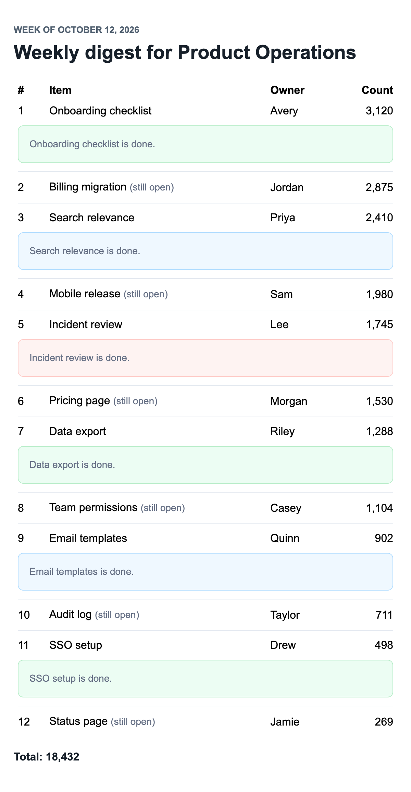

# Build a data-heavy digest email

This guide builds a weekly digest from an array of twelve rows, with loops, conditions and a number-formatting helper, and takes about 15 minutes.



The files live in `examples/guides/digest/`. `data.json` holds a workspace name, a period label, a total and twelve rows, each with a title, an owner, a count, a tone and a `done` flag:

```json file=examples/guides/digest/data.json
{
  "workspaceName": "Product Operations",
  "periodLabel": "Week of October 12, 2026",
  "total": 18432,
  "rows": [
    { "title": "Onboarding checklist", "owner": "Avery", "count": 3120, "tone": "success", "done": true },
    { "title": "Billing migration", "owner": "Jordan", "count": 2875, "tone": "warning", "done": false },
    { "title": "Search relevance", "owner": "Priya", "count": 2410, "tone": "info", "done": true },
    { "title": "Mobile release", "owner": "Sam", "count": 1980, "tone": "neutral", "done": false },
    { "title": "Incident review", "owner": "Lee", "count": 1745, "tone": "danger", "done": true },
    { "title": "Pricing page", "owner": "Morgan", "count": 1530, "tone": "info", "done": false },
    { "title": "Data export", "owner": "Riley", "count": 1288, "tone": "success", "done": true },
    { "title": "Team permissions", "owner": "Casey", "count": 1104, "tone": "neutral", "done": false },
    { "title": "Email templates", "owner": "Quinn", "count": 902, "tone": "info", "done": true },
    { "title": "Audit log", "owner": "Taylor", "count": 711, "tone": "warning", "done": false },
    { "title": "SSO setup", "owner": "Drew", "count": 498, "tone": "success", "done": true },
    { "title": "Status page", "owner": "Jamie", "count": 269, "tone": "neutral", "done": false }
  ]
}
```

## The template

```html file=examples/guides/digest/digest.html
<email>
  <preview>Your weekly digest for {{workspaceName}} is ready.</preview>
  <container>
    <section padding="36" background="#ffffff">
      <p class="eyebrow">{{periodLabel}}</p>
      <h1 class="headline">Weekly digest for {{workspaceName}}</h1>
      <spacer size="24" />
      {{#if rows.length}}
      <table width="100%" cellpadding="6" cellspacing="0">
        <tr>
          <th align="left">#</th>
          <th align="left">Item</th>
          <th align="left">Owner</th>
          <th align="right">Count</th>
        </tr>
        {{#each rows}}
        <tr>
          <td>{{position @index}}</td>
          <td>{{title}}{{#unless done}} <span class="muted">(still open)</span>{{/unless}}</td>
          <td>{{owner}}</td>
          <td align="right">{{formatNumber count}}</td>
        </tr>
        {{#if done}}
        <tr>
          <td colspan="4">
            <panel tone="{{tone}}">
              <p class="muted">{{title}} is done.</p>
            </panel>
          </td>
        </tr>
        {{/if}}
        {{#unless @last}}
        <tr>
          <td colspan="4"><divider /></td>
        </tr>
        {{/unless}}
        {{/each}}
      </table>
      {{else}}
      <p class="body-copy">Nothing moved in {{workspaceName}} this week.</p>
      {{/if}}
      <spacer size="24" />
      <p class="feature-title">Total: {{formatNumber total}}</p>
    </section>
  </container>
</email>
```

`{{#if rows.length}}` shows the table when there are rows, and `{{else}}` shows the empty state when `rows` is `[]`. Use `{{#if}}` for a number check rather than a bare `{{#rows.length}}` block, because a bare block over `0` still renders.

`{{#each rows}}` repeats its body once per row, with that row as the context, so `{{title}}` reads the row's own title. Inside the loop, `@index` is the row's position counted from zero. The template prints it through a `position` helper that adds one, so the first row shows `1`.

`@last` is true only on the final row, so `{{#unless @last}}` places a divider between rows but not after the last one. `{{#unless done}}` marks the rows still open, and `{{#if done}}` adds a panel under the finished ones, its tone taken from the row.

`{{formatNumber count}}` calls a helper that `send.mjs` registers. A helper's string result is escaped like any variable, which suits formatted numbers.

## The styles

```css file=examples/guides/digest/digest.css
body {
  font-family: Arial, Helvetica, sans-serif;
}

.eyebrow {
  color: #516070;
  font-size: 13px;
  font-weight: 700;
  margin: 0 0 10px;
  text-transform: uppercase;
}

.headline {
  color: #17202a;
  font-size: 28px;
  font-weight: 800;
  line-height: 1.16;
  margin: 0;
}

.body-copy {
  color: #344054;
  font-size: 16px;
  line-height: 1.58;
  margin: 0;
}

.muted {
  color: #667085;
  font-size: 14px;
  line-height: 1.5;
  margin: 0;
}

.feature-title {
  color: #17202a;
  font-size: 16px;
  font-weight: 800;
  line-height: 1.35;
  margin: 0 0 4px;
}
```

## The script

```js file=examples/guides/digest/send.mjs
import { readFileSync } from 'node:fs';
import { compileEmailTemplate } from 'inline-email';

const html = readFileSync(new URL('./digest.html', import.meta.url), 'utf8');
const css = readFileSync(new URL('./digest.css', import.meta.url), 'utf8');
const data = JSON.parse(readFileSync(new URL('./data.json', import.meta.url), 'utf8'));

const numberFormat = new Intl.NumberFormat('en-US');
const formatNumber = (value) => numberFormat.format(value);
const position = (index) => index + 1;

const template = await compileEmailTemplate({
  subject: 'Weekly digest for {{workspaceName}}',
  text: '{{workspaceName}}, {{periodLabel}}: {{formatNumber total}} items moved.',
  html,
  css,
  handlebars: { helpers: { formatNumber, position } }
});

console.log(JSON.stringify(template.render({ data }), null, 2));
```

The script compiles once, with the two helpers under `handlebars.helpers`, then renders with the data. Each panel takes its tone from the data, like `tone="{{tone}}"`, and gets that tone's built-in colours. Passing `style.tones` to `render({ data, style })` overrides them, even one of `background`, `border` or `text` at a time.

## Run it

In your own project, run `npm install inline-email`, save `digest.html`, `digest.css`, `data.json` and `send.mjs` in one folder, and run `node send.mjs` there.

From a checkout of this repository, build the library and run the script:

```sh
npm run build
node examples/guides/digest/send.mjs
```

It prints the subject, the html and the text as JSON. Trimmed, the text part and the first row look like this:

```text
"text": "Product Operations, Week of October 12, 2026: 18,432 items moved."
<tr>
  <td>1</td>
  <td>Onboarding checklist</td>
  <td>Avery</td>
  <td align="right">3,120</td>
</tr>
```

The html has twelve rows, eleven dividers and the line `Total: 18,432`.

The digest is also in the example gallery, with every guide's email, under "Guides": run `npm run examples:serve`, then open `http://localhost:4173`.

Next: read the [reference](../reference.md) for the full template syntax, or go back to the [README](../../README.md).
