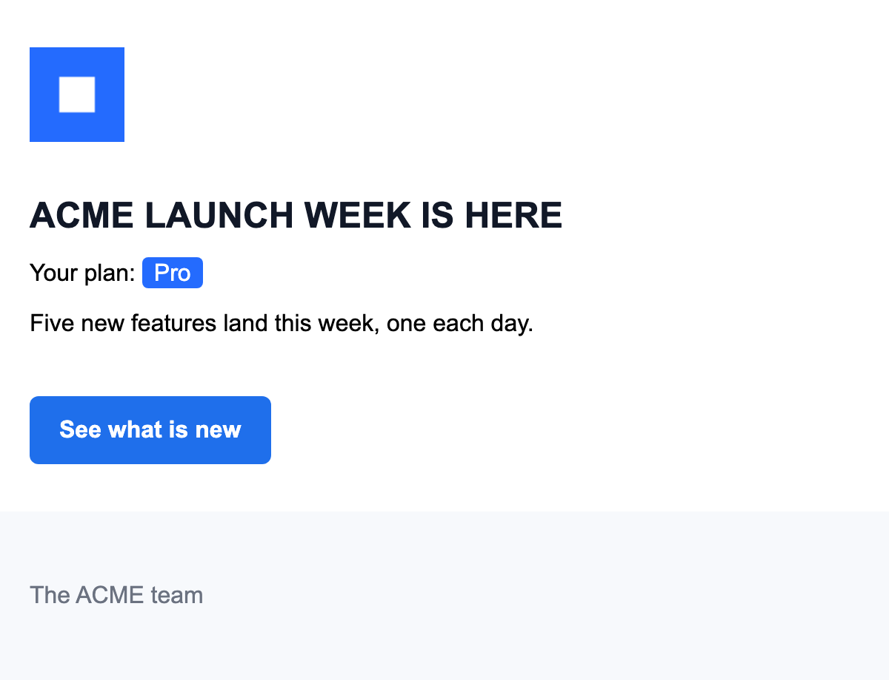

# Marketing email: helpers, partials and an inlined logo

This guide builds a launch announcement with custom helpers, a shared signature partial and a logo embedded in the email, in about 15 minutes.



You need a checkout of inline-email, built with `npm run build`, or an app with `inline-email` installed.
The script also imports `handlebars` itself, so install it in your app with `npm install handlebars` rather than relying on inline-email's copy.

## The template

The template lives in `examples/guides/marketing/launch.html`.

```html file=examples/guides/marketing/launch.html
<email>
  <preview>{{headline}}</preview>
  <container>
    <section padding="32">
      
      <spacer size="16" />
      <h1 class="headline">{{shout headline}}</h1>
      <p>Your plan: {{badge plan}}</p>
      <p>{{body}}</p>
      <spacer size="24" />
      <button href="{{launchUrl}}">See what is new</button>
    </section>
    <footer padding="32">{{> signature}}</footer>
  </container>
</email>
```

`{{shout headline}}` and `{{badge plan}}` call helpers that the script defines.
`{{> signature}}` inserts a partial, also defined in the script.
`` points at a local file next to the template:


## The script

The script lives in `examples/guides/marketing/send.mjs`.

```js file=examples/guides/marketing/send.mjs
import { readFileSync } from 'node:fs';
import { fileURLToPath } from 'node:url';
import Handlebars from 'handlebars';
import { compileEmailTemplate } from 'inline-email';

const html = readFileSync(new URL('./launch.html', import.meta.url), 'utf8');
const css = 'body { font-family: Arial, Helvetica, sans-serif; } .headline { font-size: 24px; color: #111827; }';

const compiled = await compileEmailTemplate({
  subject: '{{headline}}',
  html,
  css,
  text: '{{headline}}. See what is new at {{launchUrl}}.',
  juice: {
    webResources: {
      images: true,
      strict: true,
      relativeTo: fileURLToPath(new URL('.', import.meta.url))
    }
  },
  handlebars: {
    helpers: {
      shout: (value) => String(value).toUpperCase(),
      badge: (value) => {
        const label = Handlebars.escapeExpression(value);
        return new Handlebars.SafeString(
          `<span style="background:#246BFE;color:#ffffff;padding:2px 8px;border-radius:4px;">${label}</span>`
        );
      }
    },
    partials: {
      signature: '<p style="color:#6b7280;">The ACME team</p>'
    }
  }
});

const email = compiled.render({
  data: {
    headline: 'ACME Launch Week is here',
    plan: 'Pro',
    body: 'Five new features land this week, one each day.',
    launchUrl: 'https://acme.example/launch'
  }
});

console.log(JSON.stringify(email, null, 2));
```

### Helpers and escaping

A helper's plain string result is HTML-escaped like any other value.
`shout` returns plain text, so it needs nothing more.
`badge` returns markup, so it wraps the HTML in `new Handlebars.SafeString(html)` to insert it unescaped.
Any data placed inside that markup still goes through `Handlebars.escapeExpression`, so a plan name cannot inject HTML.

### The partial

`partials.signature` registers the footer text that `{{> signature}}` inserts.
Partials and helper output are inserted at render time.
That is after layout tags are expanded and CSS is inlined, so they get neither.
This is why the partial and the badge carry their own inline styles instead of using classes from `css`.

### The inlined logo

`juice.webResources.images` embeds images as data URIs when the template is compiled.
Relative paths such as `logo.png` resolve against `relativeTo`, here the script's own directory.
Each of `images`, `links`, `scripts` and `svgs` takes `true`, `false` or a size cap in kilobytes.
A resource larger than the cap is left as a reference.
By default an image that cannot be reached is skipped with a warning on stderr and keeps its URL.
`webResources.strict: true` makes the compile reject instead.
The example opts in because a marketing email with a broken image should not go out.
A password reset is different: it should still send with a missing logo, so leave `strict` off there.

An image whose `src` is a placeholder such as `{{logoUrl}}` cannot be inlined.
Inlining happens at compile time, before rendering fills in the placeholder.

## Run it

From a checkout, build the library and run the script:

```sh
npm run build
node examples/guides/marketing/send.mjs
```

In your own app, run `npm install inline-email handlebars`, save `launch.html`, `logo.png` and `send.mjs` in one folder, and run `node send.mjs` there.

The script prints the rendered email as JSON.
These are the meaningful lines of the HTML, with the data URI shortened:

```html

<h1 class="headline" style="font-size: 24px; color: #111827;">ACME LAUNCH WEEK IS HERE</h1>
<p>Your plan: <span style="background:#246BFE;color:#ffffff;padding:2px 8px;border-radius:4px;">Pro</span></p>
<td class="ie-section" style="padding:32px;"><p style="color:#6b7280;">The ACME team</p></td>
```

The subject and text are rendered too:

```json
"subject": "ACME Launch Week is here",
"text": "ACME Launch Week is here. See what is new at https://acme.example/launch."
```

The logo is now part of the email, the headline is upper-cased, the badge is real markup and the signature sits in the footer.

Next: [Digest email](digest.md), or the reference section on [helpers, partials and engine options](../reference.md#helpers-partials-and-engine-options).
